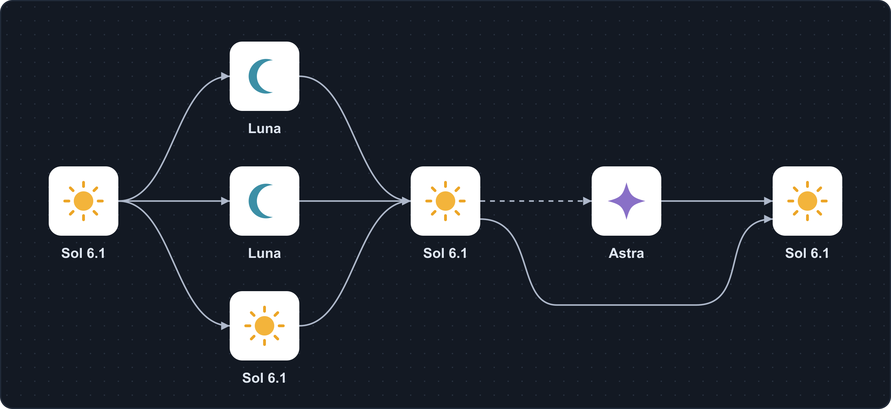

# 6.1 Sol Orch

**A Codex skill that delegates bounded work when useful and keeps integration and verification with the root agent.**

[한국어](README.md) · [Skill instructions](skills/6-1-sol-orch/SKILL.md) · [Apache-2.0](LICENSE)



This is the recommended flow when delegation is useful. The middle column contains the **explorer, researcher, and worker**, from top to bottom. The next Sol handles **integration and verification**; the rightmost Sol handles **final checks**. The dashed edge adds Astra review when needed; the lower bypass skips review.

*The sun, crescent, and star are original explanatory symbols, not official model logos.*

Use explorers and researchers for independent questions, a worker for a scoped implementation, and an independent reviewer when concrete risk justifies it. Small or tightly coupled tasks stay with the root. The skill does not launch every role on every task.

This repository ships instructions and UI metadata, not an executable orchestrator or model configuration. Agent tools and model availability depend on your Codex environment.

## Intended roles

| Role | Target model ID | Reasoning | Responsibility |
| --- | --- | --- | --- |
| Root / orchestrator | `gpt-6.1-sol` | medium | Decisions, task boundaries, integration, final verification |
| Explorer | `gpt-6-luna` | high | Read-only investigation of code and dependencies |
| Researcher | `gpt-6-luna` | high | Focused research using current primary sources |
| Worker | `gpt-6.1-sol` | high | Bounded implementation and relevant tests |
| Optional reviewer | `gpt-6-astra` | low | Independent review of consequential defects |

**Check the model IDs and reasoning levels available in your own environment.** These target IDs are not guaranteed across clients, accounts, or workspaces. Report actual fallback models accurately.

## Install

If your Codex environment includes GitHub skill installation, ask it:

```text
Install the Codex skill from this GitHub path:
https://github.com/Kimhyuntae9665/codex-skill-6-1-sol-orch/tree/main/skills/6-1-sol-orch
```

For manual installation, Git is required. Run the following from a directory where the repository has not already been cloned. The destination is the user skill location in the current official docs: `~/.agents/skills`.

**Windows PowerShell**

```powershell
git clone https://github.com/Kimhyuntae9665/codex-skill-6-1-sol-orch.git
if ($LASTEXITCODE -ne 0) { throw 'Git clone failed.' }
$skillTarget = Join-Path $HOME '.agents/skills/6-1-sol-orch'
if (Test-Path -LiteralPath $skillTarget) { throw 'Skill already exists. Back it up before updating.' }
New-Item -ItemType Directory -Path (Split-Path $skillTarget) -Force | Out-Null
Copy-Item -LiteralPath './codex-skill-6-1-sol-orch/skills/6-1-sol-orch' -Destination $skillTarget -Recurse
```

**macOS / Linux**

```sh
(
  set -eu
  git clone https://github.com/Kimhyuntae9665/codex-skill-6-1-sol-orch.git
  skill_target="$HOME/.agents/skills/6-1-sol-orch"
  if [ -e "$skill_target" ]; then
    echo 'Skill already exists. Back it up before updating.' >&2
    exit 1
  fi
  mkdir -p "$HOME/.agents/skills"
  cp -R ./codex-skill-6-1-sol-orch/skills/6-1-sol-orch "$skill_target"
)
```

Check your client's skill list for `6-1-sol-orch`. If it is missing, open a new conversation or restart the client. Some bundled GitHub installers default to `$CODEX_HOME/skills` or `~/.codex/skills`; use the discovery path supported by your environment and avoid duplicate installations.

For project-only use, copy the skill folder to the project's `.agents/skills/6-1-sol-orch` instead. Installing this folder does not require changing an existing `config.toml` or `AGENTS.md`.

## Use

Select your root model in the host first; the intended root is `gpt-6.1-sol` with medium reasoning. Confirm that subagents and the requested child models are available, then invoke the skill:

```text
$6-1-sol-orch
Add a date filter to the order CSV export.
Have an explorer map the current API and tests.
Give a worker ownership of the relevant files.
Integrate the result and verify the final behavior.
```

For research and documentation:

```text
$6-1-sol-orch
Rewrite this project's installation README for first-time users.
Have a researcher verify requirements against official sources.
Compare those findings with the local files, then write and check the steps.
```

**Invoking a skill cannot change the already-running root model.** This repository does not install per-agent model configuration files. Consult the active tool schema and [official subagent docs](https://developers.openai.com/codex/multi-agent) for model selection in your environment. A different root or unavailable model must be reported accurately.

## Operating rules

- Delegate only independent, bounded work worth the coordination overhead.
- Assign one writer per file or subsystem, with explicit scope and completion checks.
- Inspect returned evidence before making dependent decisions or integrating changes.
- The worker runs focused tests; the root verifies the integrated result. There is no standing tester role.
- Add independent review for material security, data-integrity, concurrency, compatibility, cross-component risk, or a concrete unresolved verification concern.
- Respect host permissions, tool capabilities, and available concurrency slots.

The UI metadata permits implicit skill selection, but the skill itself requires user or applicable-instruction authorization before delegating. Explicit `$6-1-sol-orch` invocation requests this workflow. It does not independently authorize deployment, publishing, final submission, or external contact.

Small tasks may finish entirely with the root. Without subagent tools, the root carries out the work and reports the limitation.

## Cost and limitations

The design avoids unnecessary delegation on small tasks. Token savings and speed improvements have not been measured. Subagents can consume additional tokens and waiting time; check your account limits and model costs.

## Files and attribution

The installable folder is `skills/6-1-sol-orch`, containing `SKILL.md`, `agents/openai.yaml`, `LICENSE`, and `NOTICE`. License and attribution travel with the folder when installed separately.

The diagram includes an editable [SVG](assets/orchestration-flow.svg), a [PNG preview](assets/orchestration-flow.png), and [graph/asset sources](assets/flow-source/README.md). The original artwork is also covered by this repository's Apache-2.0 license.

The local skill was developed from the orchestration approach in [donvito/codex-astra-luna-orchestrator](https://github.com/donvito/codex-astra-luna-orchestrator), based on commit `f1de1b8729c8ccfb7978321b4764c58bd34c8493`. Changes include Sol 6.1 root/worker roles, on-demand delegation, optional Astra review, and host-aware execution boundaries. See [NOTICE](NOTICE).

Licensed under Apache License 2.0. This is a community project, not an official OpenAI project.

Official references: [Skills](https://developers.openai.com/codex/skills), [Subagents](https://developers.openai.com/codex/multi-agent), [Configuration reference](https://developers.openai.com/codex/config).
